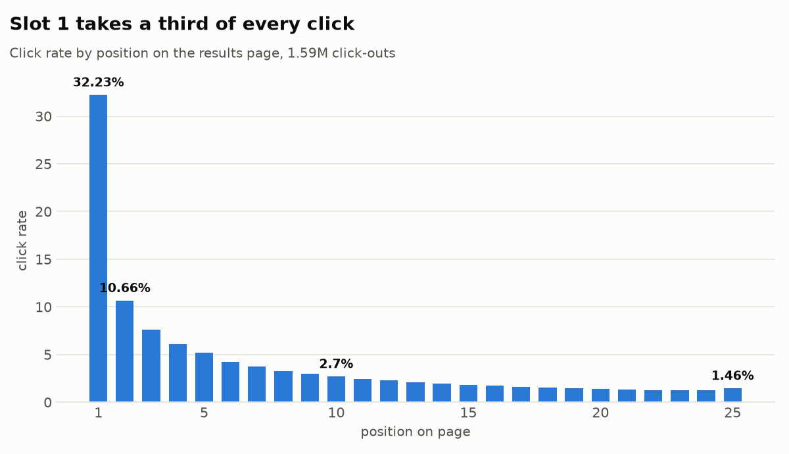
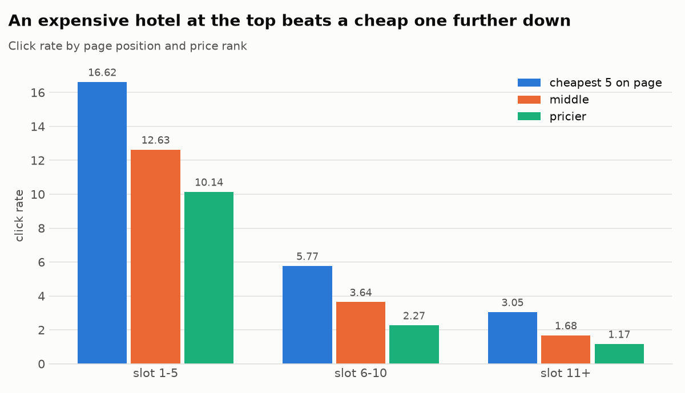
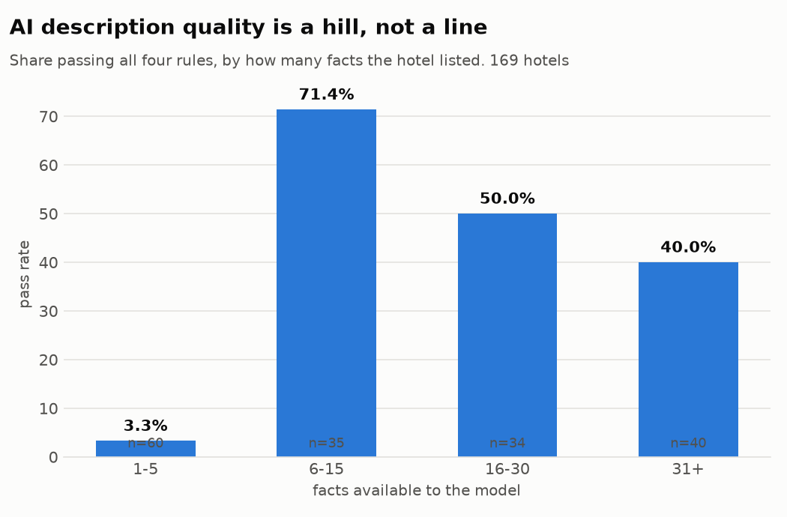
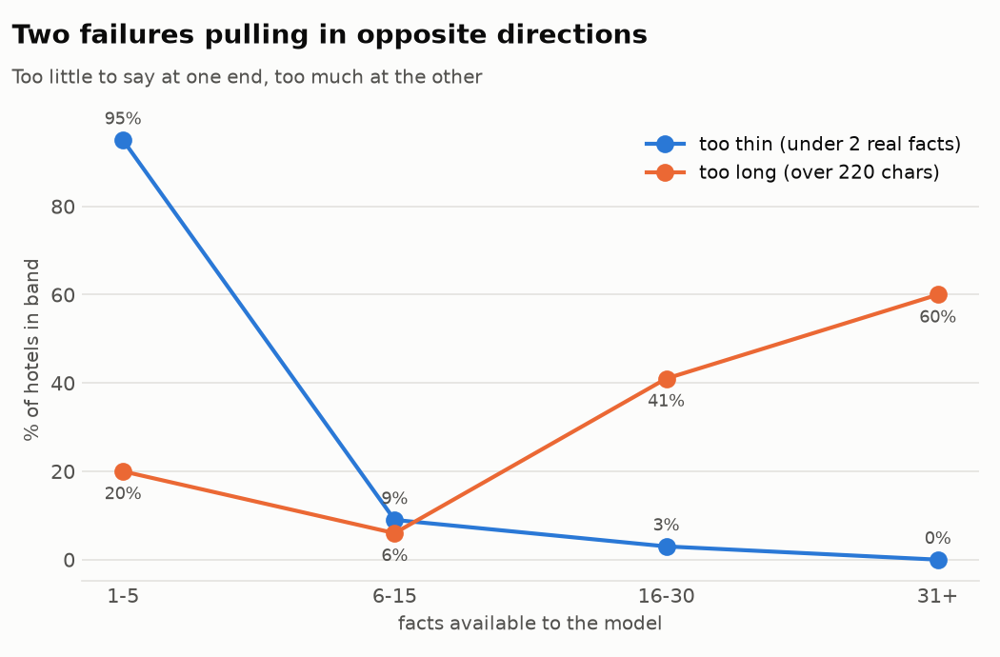

# Hotel search behaviour and AI content quality

An analysis of trivago's public hotel search dataset. 15.9 million user actions,
910,683 sessions, 927,142 hotels.

I set out to answer three questions:

1. Why do people click the hotel they click?
2. Does trivago's ranking put better hotels at the top, or just visible ones?
3. If an AI writes hotel descriptions at scale, how would you catch a bad one?

The three answers turned out to share a root cause.

---

## 1. Position decides almost everything



Slot 1 is clicked 32.2% of the time. Slot 25 is clicked 1.5% of the time.
That is a 22-fold gap across one page.

Half of all clicks land in the top three slots. The top ten take 78%.
The remaining fifteen hotels share what is left.

One oddity worth noting: slot 25 ticks back up, 1.46% against 1.23% at slot 24.
That is people reaching the bottom of the page and noticing the last item.

## 2. Price matters far less than people assume



The cheapest hotel on a page is clicked 10.2% of the time. The most expensive is
clicked 3.3%. A 3-fold spread, against 22-fold for position.

Put them together and the picture is blunt. An expensive hotel in the top five
beats the cheapest hotel below slot ten by 3.3 to 1.

Price also stops working early. Between the 15th cheapest and the 25th cheapest
the click rate does not move at all: 3.28% against 3.26%. Being the cheapest
option is worth something. Being moderately cheap is worth nothing.

## 3. The ranking rewards complete listings, not better hotels

My first pass suggested top-slot hotels were better rated. They are not. That
result came from treating 42.5% of hotels with no rating as if they scored zero.

Excluding the blanks, guest rating by page position is 2.81, 2.79 and 2.78 on a
four-point scale. Rating explains nothing.

Two other things do move:

| | slot 1-5 | slot 11+ |
|---|---|---|
| hotels with no rating at all | 12.0% | 17.4% |
| amenities listed | 42.1 | 36.2 |

Both measure how much trivago knows about a hotel, not how good the hotel is.

The filtering starts even earlier. Across the whole catalogue 42.5% of hotels
have no rating, but among hotels that actually appear on a results page only
15.6% do. An unrated hotel is 2.7 times less likely to be shown at all.

## 4. AI-written descriptions fail in two opposite ways

I wrote four rules first, then generated descriptions for 169 hotels with a small
language model, then scored them. Writing the rules before generating is what
makes the number honest. Rules written afterwards tend to be rules the output
already passes.

The rules: no amenity that is absent from the hotel's own property list; under
220 characters; at least two real properties mentioned; not an 80% word overlap
with another hotel's description.

**60 of 169 passed. 35.5%.**



Quality is a hill. It peaks at 6-15 facts and falls away at both ends.



Two failures run in opposite directions and cross in the middle. With almost
nothing to work with the model refuses to write or produces filler. With a long
property list it tries to use all of it and overruns the card.

The surprise: the model invents least when it knows least. Invention runs at 2%
in the sparsest band and 17% in the 6-15 band. Given nothing, it hedges. Given
some material, it writes confident prose, and confident prose is where things get
embroidered.

One real example. Hotel 7234886 lists `WiFi (Rooms)` and `WiFi (Public Areas)`.
The description said "free WiFi". The data never said free. One adjective, and a
traveller arrives to a charge nobody promised.

Outright invention was the smallest failure category, 14 of 169. The bigger
problems were duller: nothing useful said, or too much said.

---

## What I would do about it

1. Ranking is the highest-leverage surface in the product. A slot-1 placement is
   worth more than any price advantage a hotel can offer.
2. Price promotion only works at the very top of the range. Moving a hotel from
   20th cheapest to 15th changes nothing measurable.
3. Fill content gaps before improving hotel selection. Completeness predicts
   placement. Quality does not.
4. The AI content failures need a tighter prompt with a hard length limit, not a
   bigger model. That alone removes 52 of the 109 failures.
5. Hotels below roughly six recorded facts should not get AI descriptions at all.
   In that band the output is unusable 97% of the time.
6. Rules catch known failure types cheaply and at scale. They cannot catch
   unknown ones. Human review on a sample covers the rest, and both are needed.

## The thread running through all of it

Content completeness decides whether a hotel gets seen, and it decides whether
AI-generated content about it is usable. Sparse listings fail twice. Question 3
and question 4 arrived at the same place from opposite directions.

## What this analysis cannot tell you

- The data is from 2018. It describes that period.
- 90.8% of sessions here contain a click-out. That is not trivago's conversion
  rate. The dataset was built for a click-out prediction challenge, so sessions
  were selected around click-outs. I use it only for within-dataset comparison.
- Position and clicks move together. This cannot show that position causes
  clicks, because the ranking may simply be good at its job. Separating the two
  needs randomised ranking, which observational data cannot provide.
- Amenity count stands in for listing completeness, but it also tracks hotel
  size. Splitting the two needs a completeness measure independent of the
  property itself, such as photo count or description length.
- The content scorer checks a fixed list of about 45 claim phrases. It catches
  commercially important inventions, not every possible one.
- There is no booking-partner column, so this says nothing about how trivago's
  partners compare on price.

## Running it yourself

```
pip install -r requirements.txt
# put train.csv and item_metadata.csv in data/
python scripts/00_setup_check.py
duckdb trivago.duckdb        # then run the files in sql/
python scripts/02_generate.py   # needs ANTHROPIC_API_KEY
python scripts/03_score.py
python scripts/04_charts.py
```

Queries live in `sql/`. Scripts in `scripts/`. Every number in this README comes
out of one of them.

## Data

trivago RecSys Challenge 2019 dataset.
Source: https://recsys.trivago.cloud/challenge/dataset/

The data files are not in this repo. Code and findings only.
